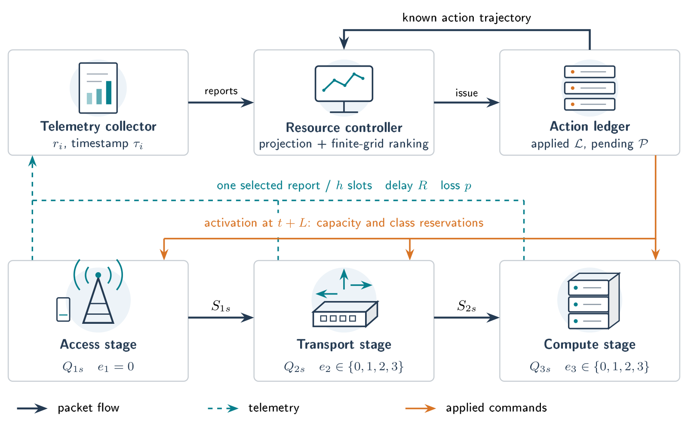
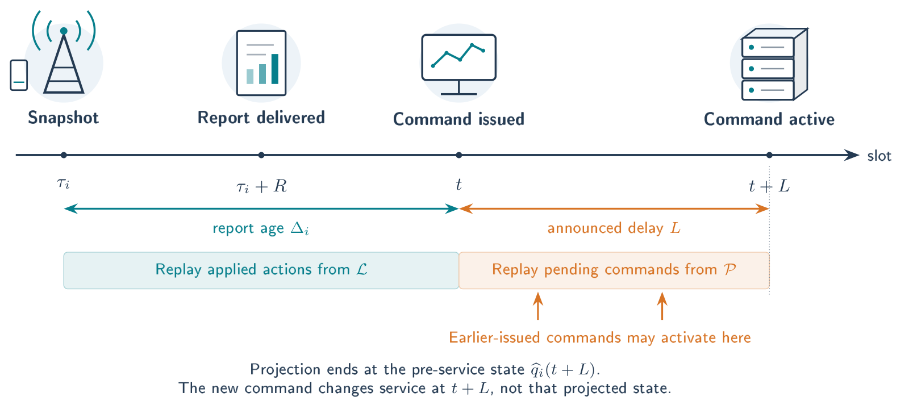
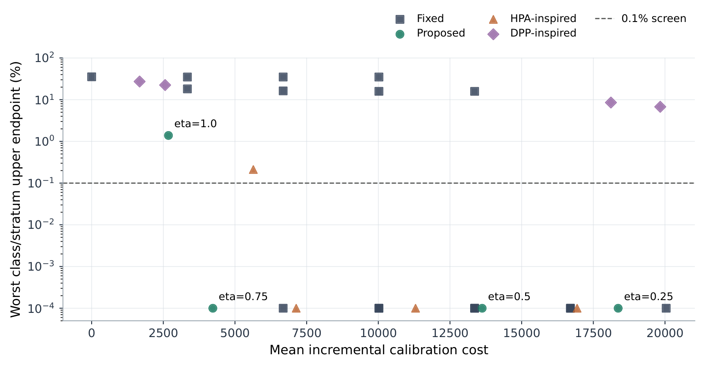
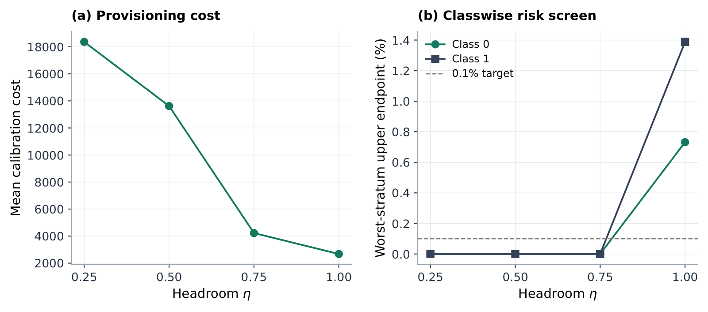
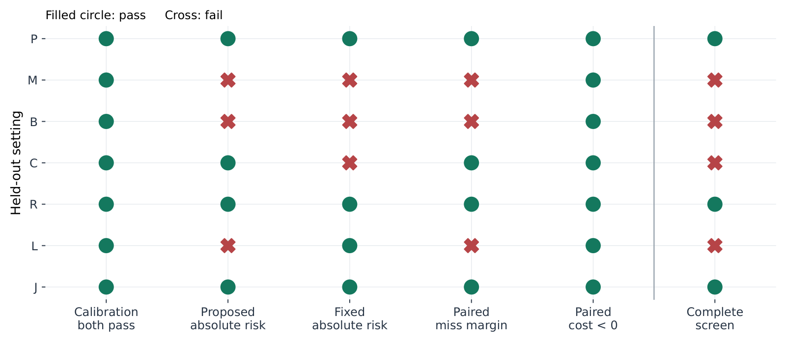
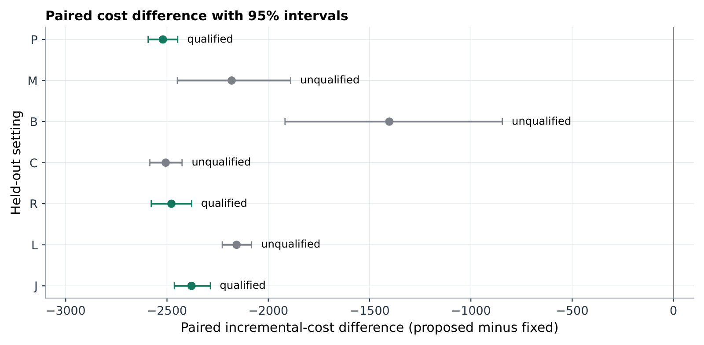
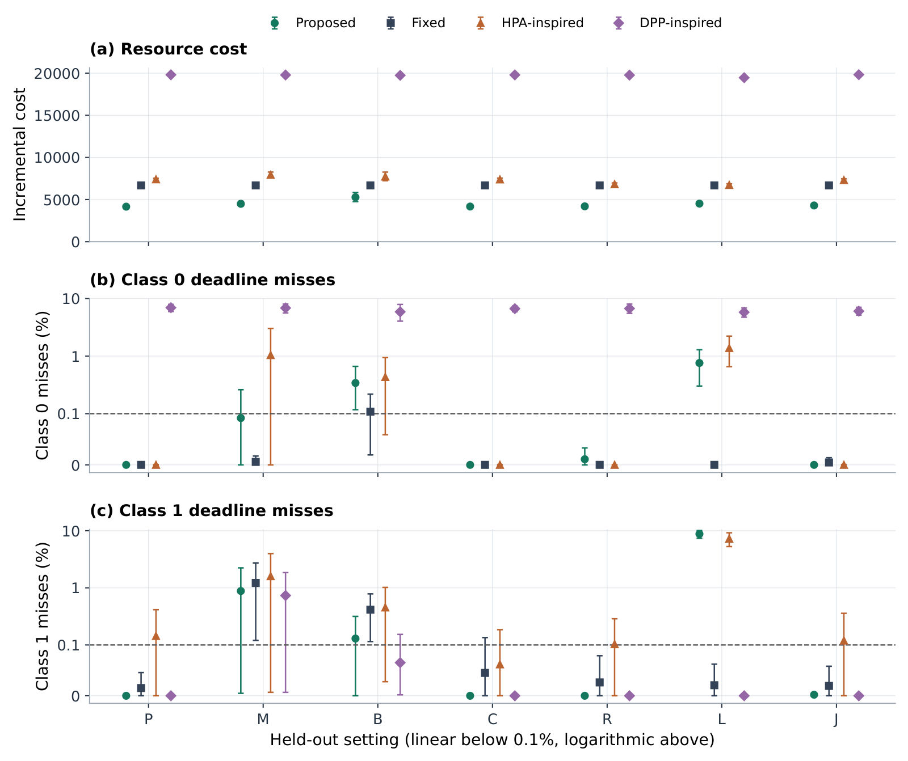
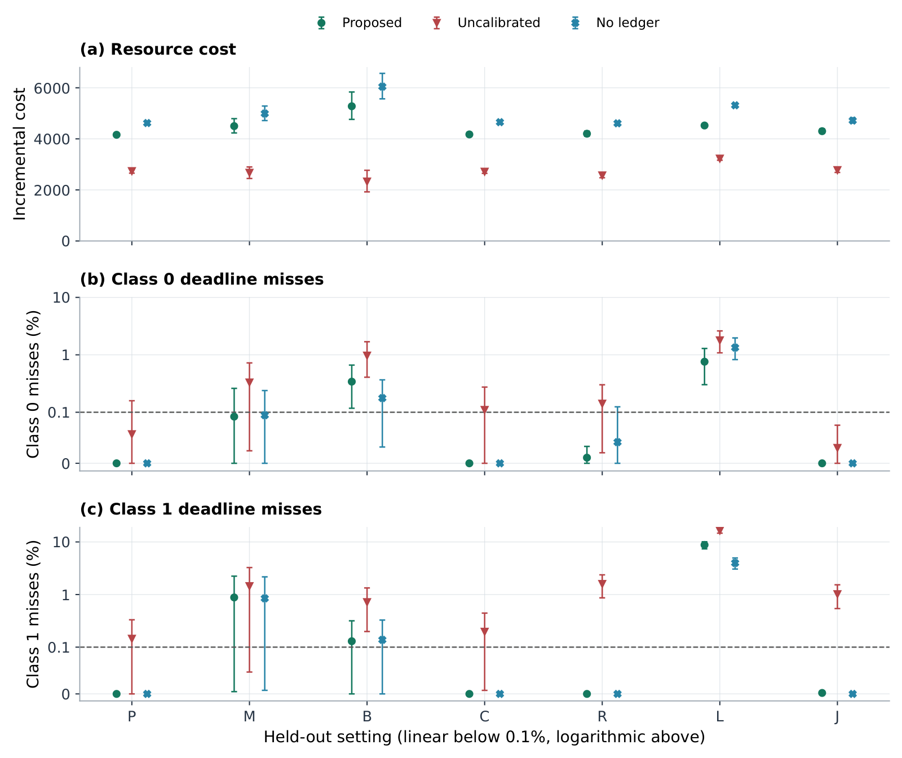
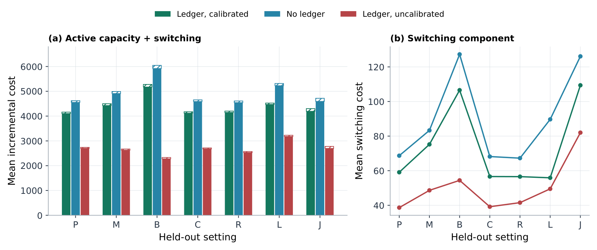
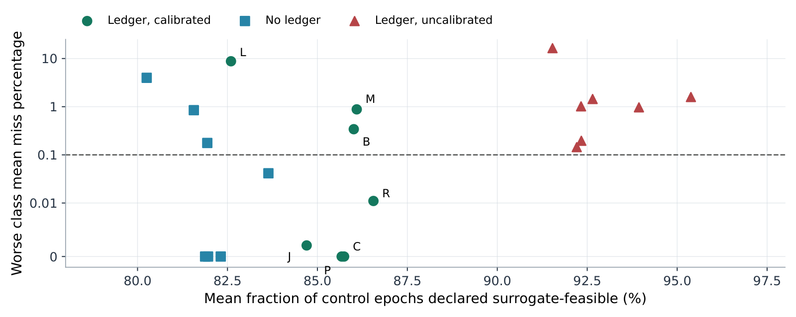

# Reliability-Screened Capacity Elasticity under Delayed Telemetry and Actuation

<p align="center"><strong>Reproducible simulation · Delayed telemetry · Capacity elasticity</strong><br>1,176 execution records · 10 figures · 2 algorithms</p>

<p align="center"><a href="paper_reliability/Manuscript.pdf">Read the paper</a> · <a href="docs/figures/README.md">Explore all figures</a> · <a href="PAPER_README.md">Reproduce the study</a></p>

## Architecture and control sequence

### System architecture

[](submission_figures/Figure_1_Architecture.pdf)

Access, transport and compute stages, telemetry reports and the controller's action ledger. Equipment icons describe model roles rather than implemented O-RAN hardware.

[Vector PDF](submission_figures/Figure_1_Architecture.pdf) · [PNG](docs/figures/01-architecture.png)

### Observation-to-activation timeline

[](submission_figures/Figure_2_Timeline.pdf)

The causal sequence from delayed reports to command activation. Projection replays only actions already issued.

[Vector PDF](submission_figures/Figure_2_Timeline.pdf) · [PNG](docs/figures/02-control-timeline.png)

## Results at a glance

The panels reproduce the manuscript figures. Open the [full figure gallery](docs/figures/README.md) for larger previews, interpretation and downloads. This is an abstract service-chain simulation. Distribution-shift and long-delay failures remain part of the reported results.

| Figure 3 · Calibration and candidate selection | Figure 4 · Headroom sensitivity |
| :---: | :---: |
| [](paper_reliability/calibration.pdf) | [](paper_reliability/headroom_sensitivity.pdf) |
| [Vector PDF](paper_reliability/calibration.pdf) · [PNG](docs/figures/03-calibration.png) | [Vector PDF](paper_reliability/headroom_sensitivity.pdf) · [PNG](docs/figures/04-headroom-sensitivity.png) |

| Figure 5 · Reliability qualification | Figure 6 · Paired cost differences |
| :---: | :---: |
| [](paper_reliability/screen_matrix.pdf) | [](paper_reliability/qualified_cost.pdf) |
| [Vector PDF](paper_reliability/screen_matrix.pdf) · [PNG](docs/figures/05-reliability-screen.png) | [Vector PDF](paper_reliability/qualified_cost.pdf) · [PNG](docs/figures/06-qualified-cost.png) |

| Figure 7 · Held-out performance | Figure 8 · Component ablations |
| :---: | :---: |
| [](paper_reliability/reliability_primary.pdf) | [](paper_reliability/reliability_ablation.pdf) |
| [Vector PDF](paper_reliability/reliability_primary.pdf) · [PNG](docs/figures/07-held-out-results.png) | [Vector PDF](paper_reliability/reliability_ablation.pdf) · [PNG](docs/figures/08-component-ablations.png) |

| Figure 9 · Cost decomposition | Figure 10 · Proxy versus realized outcome |
| :---: | :---: |
| [](paper_reliability/cost_components.pdf) | [](paper_reliability/proxy_vs_outcome.pdf) |
| [Vector PDF](paper_reliability/cost_components.pdf) · [PNG](docs/figures/09-cost-components.png) | [Vector PDF](paper_reliability/proxy_vs_outcome.pdf) · [PNG](docs/figures/10-proxy-outcome.png) |

## Study and reproduction notes

### Current release: 24 October 2026

See `COLUMN_REVISION.md` for single-column algorithms, reference updates and GitHub publication status.

Read `paper_reliability/Manuscript.pdf` and `PAPER_README.md` first.
The current paper adds separate headroom calibration, a common reliability
screen, transparent HPA/DPP-inspired adaptations, workload shift and variable
command-delay tests. It includes 336 calibration and 840 held-out executions,
43 references, two algorithms, ten vector figures and 35 paired contrasts.
Verification passes 51 unit-test methods and all result verifiers.
Qualified cost reductions of 35.61–37.73% occur in three fixed-reference
comparisons. Important distribution-shift and long-delay failures remain.
This is an abstract simulation paper, not a physical O-RAN validation or a
guarantee of publication. Earlier manuscripts and reports remain as history.
The historical V2 description below is preserved. NumPy is required for the new
statistical analysis, while the simulation kernels remain standard-library Python.


<details>
<summary><strong>Historical pilot documentation</strong></summary>

## Historical V2 description

Student: Fatima Subhi Khaleel

Working paper: Joint Telemetry Refresh and Resource Allocation for Delay-Constrained SDN-Orchestrated O-RAN

## What this deliverable is

A reproducible, standard-library Python tandem-queue experiment. It is **not** a
complete O-RAN emulator, an NR link/system simulator, a deployed xApp, or final
evidence for a Transactions manuscript. The original pilot is preserved byte
for byte in `baseline/` for reference, including its original results.

```
python baseline/simulate.py --test
python experiment.py --test
python experiment.py --seeds 20 --measure 3000 --output results_v2.json
```

Requires Python 3.10+. Run these commands from the extracted package directory.

## Changes made before evaluation

1. The local scheduler redistributes unused reserved capacity, using earliest
   absolute deadline to assign the spare units. The controller still cannot
   inspect unreported global queues. The local scheduler can inspect its own
   queues, as can the local execution layer in all work-conserving variants.
2. Queue predictions use reported mean arrivals minus reported mean service,
   replacing the original equal-service assumption.
3. A new report-selection heuristic weights historical net-flow dispersion,
   age, deadline and predicted pressure. Dispersion is only an uncertainty
   **proxy**, not a calibrated confidence interval or probabilistic guarantee.
4. A fixed 300-slot warmup excludes startup arrivals from the measured cohort.
5. A 40-slot observation tail follows the measurement interval. Background
   traffic continues normally, so measured packets do not benefit from an
   artificial no-arrival drain period. Every measured packet's deadline has
   elapsed by the final horizon. Unfinished measured packets count as deadline
   violations. Completed delay percentiles remain completion-conditioned.
6. Paired seed-level differences and 2,000-resample paired bootstrap intervals
   accompany raw per-seed results. These are exploratory intervals without
   multiplicity adjustment, not confirmatory tests.

## Fair comparisons and ablations

| Configuration | Report selection | Spare-capacity borrowing | Reported-service prediction |
|---|---|---|---|
| legacy_periodic | Cyclic | No | No |
| legacy_oldest | Oldest report | No | No |
| legacy_impact | Original impact heuristic | No | No |
| scheduler_only | Cyclic | Yes | No |
| predictor_only | Cyclic | No | Yes |
| modern_periodic | Cyclic | Yes | Yes |
| modern_oldest | Oldest report | Yes | Yes |
| modern_risk | Dispersion/pressure heuristic | Yes | Yes |

All configurations in the new engine use identical warmup, followup and cohort
metrics. They must not be numerically equated with the old engine's output,
which had no warmup or fixed followup.

The original seed range was 0–19. The extension uses new seeds 1000–1019, without
parameter search. These are new evaluation seeds, not proof of generalization
outside this synthetic model. Four settings cover nominal demand, transport
congestion, compute congestion, and transport congestion with report delay
increased from 3 to 9 slots and report loss increased from 0.05 to 0.15.
Three settings reuse the old traffic scenario designs, while the fourth adds
an unseen delay/loss combination. All eight configurations share generated
events and request-index loss flags within each setting and seed.

Reports are requested once every five slots, one stage per request. Every
report is assumed to use the same fixed-size padded record, including fields
unused by some variants. Their transport-resource cost is still not modeled.
Measurement timestamps remain at report generation, not request delivery.

## Units and limitations

The slot is 20 ms. Synthetic deadlines are 15 and 40 slots, NOT URLLC targets.
Every packet requires one service unit in each of radio, transport and compute.
This omits heterogeneous packet sizes, CPU-cycle demands, propagation, radio
interference, HARQ, PHY/MAC operation and control protocol overheads. A pipeline
packet crosses at most one stage per slot. Arrival/capacity generation is
unchanged from baseline/simulate.py.

There is no mathematically optimized joint resource allocator or formal delay
guarantee. The report-selection heuristic may improve or worsen either class.
An overall engineering gain must not be attributed to report selection when
it is instead explained by spare-capacity borrowing. Compare modern_risk with
modern_periodic and modern_oldest to isolate report selection; compare
scheduler_only and predictor_only with legacy_periodic to inspect components.

Next gates: calibrated service/resource models, telemetry cost on transport,
validated error intervals, an explicit constrained optimizer and exact
small-instance comparator, larger scale/mobility experiments, and a full
closest-work comparison before any novelty claim. No publication readiness or
acceptance probability is asserted.

## Verification

Six original tests and five new tests cover allocation, packet conservation,
local work conservation, causal report delivery, equal trace/report budgets,
repeatability, forecast-service consistency, minimum pipeline latency and
unfinished-packet violation accounting. Packet conservation and local capacity
assertions also execute during all new runs. Passing these checks establishes
internal accounting properties, not physical realism.

The raw output is results_v2.json. Run summarize.py to regenerate the compact
RESULTS.txt overview. Negative paired differences favor modern_risk. Both
service classes and backlog are reported to expose tradeoffs.

## Interpretation of the recorded 640-run experiment

All 11 tests passed. Twenty seeds, four settings and eight configurations
produced 640 runs. Identical trace hashes, report request counts and delivered
report counts were verified across configurations for every seed/setting.

Under nominal traffic, spare-capacity borrowing alone removed all observed
deadline misses in this finite experiment. This does not prove zero violation
probability. It means the nominal scenario cannot establish added value from
report selection; much of the original apparent improvement was scheduler
inefficiency rather than a telemetry insight.

Compared with modern_oldest (the same predictor and local scheduler), modern_risk
reduced class-0 mean violation rate from 38.417% to 35.949% for transport stress,
and from 37.047% to 34.600% for compute stress. However, class-1 mean violation
rate increased from 33.266% to 33.913% and from 32.750% to 33.461%, respectively.
This is a class tradeoff, not a universal improvement. Mean total backlog is
identical across work-conserving variants because this unit-service serial
pipeline's aggregate service is work-conserving regardless of class ordering.

With increased report delay/loss, class-0 mean difference versus modern_oldest
is -0.958 percentage points, with an exploratory paired-bootstrap interval of
[-2.287, 0.250]. The interval crosses zero. There is no clear superiority in
that setting; class-1 mean violations also increase.

Using observed service for prediction without scheduler improvement worsened
both class means relative to legacy_periodic. The estimator must not be called
validated simply because it is more detailed. Its interaction with reserved
shares and delayed feedback needs explicit analysis.

Conclusion: retain the research direction, but do not turn these heuristic
results into a Transactions submission. Replace the report priority proxy with
a constrained decision that includes both classes' SLA budgets, calibrate the
prediction errors, and add a real joint resource-allocation formulation. The
fixed-size-report/equal-budget comparison remains an experimental control, not
a realistic transport-cost model.

</details>
